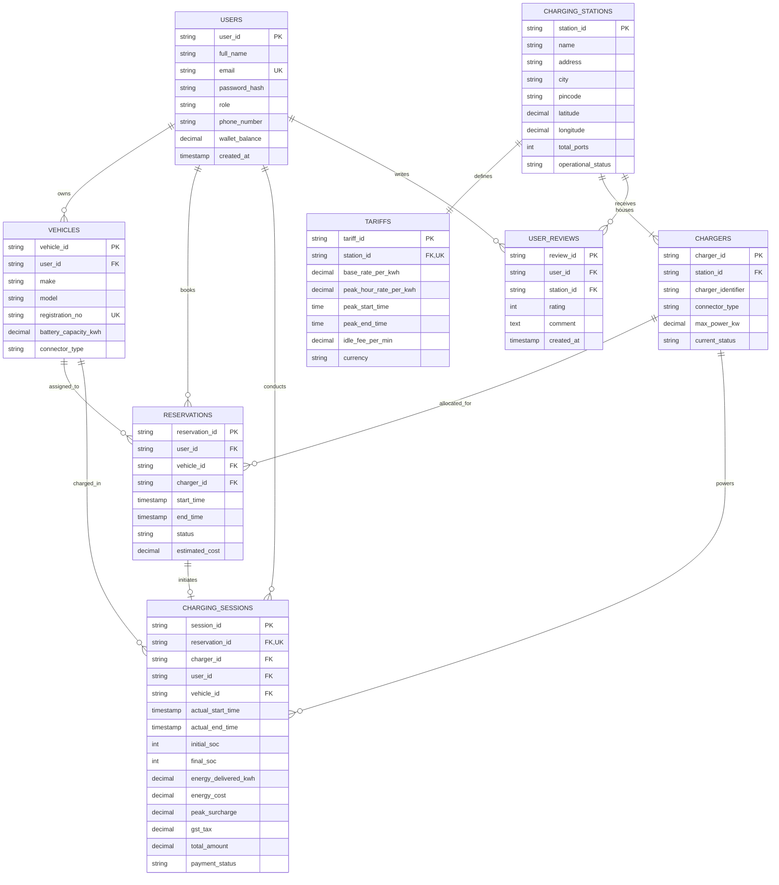

# DEPARTMENT OF COMPUTER SCIENCE AND ENGINEERING
## PES UNIVERSITY, BENGALURU
### DBMS Experiential Learning – Level 3 Project Report

---

# **VoltReserve: EV Charging Network & Smart Reservation Management System**

**Course Code:** Database Management Systems (Experiential Learning Level 3)  
**Faculty In-Charge / Guide:** Dr. Nagasundari S  
**Academic Year:** 2026–2027  

### **Project Team Details**
| Sl. No. | Student Name | SRN | Branch & Section |
|---|---|---|---|
| 1 | **Namith Kumar Chandrakumar** | **PES1UG24AM171** | CSE (AIML) |
| 2 | **Kushal G** | **PES1UG24AM145** | CSE (AIML) |

---

## Executive Summary
**VoltReserve** is an enterprise-grade EV Charging Network & Smart Reservation Management System built to address the real-world operational challenges of public electric mobility infrastructure. Traditional EV charging systems operate on a rudimentary first-come, first-served basis, resulting in queue congestion, unpredictable charger availability, and frequent hardware double-booking. VoltReserve introduces a dual-paradigm database architecture combining **PostgreSQL (Relational SQL)** for ACID-compliant, concurrency-safe slot bookings, triggers, and financial billing, with **MongoDB (NoSQL)** for high-velocity IoT telemetry ingestion and battery thermal stress aggregation. The application provides an intuitive Next.js frontend with customer and administrator portals, complete with live charging simulation and automated wallet billing.

---

## 1. Project Objectives
1. **Concurrency-Safe Charger Slot Reservation:** Provide guaranteed time-slot reservations at the database layer using atomic transactions and row-level locking (`FOR UPDATE`), ensuring zero double-booking collisions `(StartA < EndB AND EndA > StartB)`.
2. **Automated State Machine Execution via Triggers:** Enforce automatic transitions between charger states (`AVAILABLE` ➔ `RESERVED` ➔ `OCCUPIED` ➔ `AVAILABLE`) reactively via database triggers.
3. **Multi-Paradigm Database Justification:**
   - **SQL (PostgreSQL/MySQL):** Strictly enforce relational integrity, BCNF normalization, and financial accounting for Users, Vehicles, Tariffs, and Invoices.
   - **NoSQL (MongoDB):** Efficiently ingest polymorphic, high-frequency IoT sensor telemetry ticks (voltage, current, battery pack temperature) and detect cell thermal anomalies via aggregation pipelines.
4. **Advanced Analytical Query Processing:** Demonstrate advanced SQL capabilities including Common Table Expressions (CTEs) for peak-demand classification and Analytical Window Functions (`DENSE_RANK()`, `AVG() OVER()`) for station revenue ranking.
5. **Modern, Transparent UI/UX:** Deliver an intuitive Next.js web application with customer onboarding, vehicle profiles, real-time station filtering, interactive charging simulation, and automated GST billing.

---

## 2. Functional & Non-Functional Requirements

### 2.1 Functional Requirements
- **FR1 (Authentication & RBAC):** Role-Based Access Control supporting `CUSTOMER` (EV Driver) and `ADMIN` (Station Operator) with password protection and session management.
- **FR2 (Vehicle Profile Management):** 1:N relationship allowing EV drivers to register vehicles with battery capacity (kWh) and connector port standards (`CCS2`, `Type 2`, `CHAdeMO`).
- **FR3 (Live Station Explorer & Filtering):** Search stations across Bengaluru hotspots with filtering by connector type, charging power speed (&ge;50 kW DC Fast), and live availability count.
- **FR4 (Atomic Reservation Engine):** Reserve a specific charger gun for a designated time window. The database rejects any overlapping reservation attempts with explicit constraint validation.
- **FR5 (Live Charging Session Simulator):** Hardware simulator that initiates upon arrival, streams SoC% increase, tracks delivered energy (kWh), and updates charger state to `OCCUPIED`.
- **FR6 (Dynamic Tariff & Billing Engine):** Stored procedure computing base kWh rates, peak-hour surcharges (17:00–22:00), 18% GST (SAC code 998714), and auto-deducting from digital FastPass wallet.
- **FR7 (Administrator Control Center):** Fleet maintenance management (toggle `UNDER_MAINTENANCE`), peak-hour load heatmaps, and station revenue performance tracking.

### 2.2 Non-Functional Requirements
- **ACID Compliance:** Strict Atomicity, Consistency, Isolation, and Durability on reservation insertions and billing settlements.
- **Data Integrity:** Foreign key referential integrity with cascading rules and check constraints on battery capacity, ratings, and time boundaries.
- **Low Latency:** High indexing coverage on foreign keys, email, and timestamp ranges to ensure sub-10ms query execution.

---

## 3. Entity-Relationship (ER) Diagram



---

## 4. Relational Schema & BCNF Normalization

### 4.1 Relational Schema Representation
- **USERS** ($\underline{\text{user\_id}}$, full\_name, email, password\_hash, role, phone\_number, wallet\_balance, created\_at)
- **VEHICLES** ($\underline{\text{vehicle\_id}}$, $\text{user\_id}^*$, make, model, registration\_no, battery\_capacity\_kwh, connector\_type)
- **CHARGING\_STATIONS** ($\underline{\text{station\_id}}$, name, address, city, pincode, latitude, longitude, total\_ports, operational\_status)
- **TARIFFS** ($\underline{\text{tariff\_id}}$, $\text{station\_id}^*$, base\_rate\_per\_kwh, peak\_hour\_rate\_per\_kwh, peak\_start\_time, peak\_end\_time, idle\_fee\_per\_min, currency)
- **CHARGERS** ($\underline{\text{charger\_id}}$, $\text{station\_id}^*$, charger\_identifier, connector\_type, max\_power\_kw, current\_status)
- **RESERVATIONS** ($\underline{\text{reservation\_id}}$, $\text{user\_id}^*$, $\text{vehicle\_id}^*$, $\text{charger\_id}^*$, start\_time, end\_time, status, estimated\_cost)
- **CHARGING\_SESSIONS** ($\underline{\text{session\_id}}$, $\text{reservation\_id}^*$, $\text{charger\_id}^*$, $\text{user\_id}^*$, $\text{vehicle\_id}^*$, actual\_start\_time, actual\_end\_time, initial\_soc, final\_soc, energy\_delivered\_kwh, energy\_cost, peak\_surcharge, gst\_tax, total\_amount, payment\_status)
- **USER\_REVIEWS** ($\underline{\text{review\_id}}$, $\text{user\_id}^*$, $\text{station\_id}^*$, rating, comment, created\_at)

### 4.2 Normalization Analysis up to Boyce-Codd Normal Form (BCNF)
A relation $R$ is in **BCNF** if and only if for every non-trivial Functional Dependency (FD) $X \to Y$, the determinant $X$ is a **Superkey** of $R$.

1. **First Normal Form (1NF):** All attributes are atomic (scalar values). No multi-valued attributes or repeating groups exist.
2. **Second Normal Form (2NF):** The relations are in 1NF, and all non-prime attributes are fully functionally dependent on the entire primary key (no partial dependencies).
3. **Third Normal Form (3NF):** The relations are in 2NF, and no transitive dependencies exist ($X \to Y$ and $Y \to Z$ where $Z$ is non-prime).
4. **Boyce-Codd Normal Form (BCNF) Verification:**
   - In `CHARGERS`, Candidate Keys are $\{\text{charger\_id}\}$ and $\{\text{station\_id}, \text{charger\_identifier}\}$. The FDs are:
     $$\text{charger\_id} \to \{\text{station\_id}, \text{charger\_identifier}, \text{connector\_type}, \text{max\_power\_kw}, \text{current\_status}\}$$
     $$\{\text{station\_id}, \text{charger\_identifier}\} \to \{\text{charger\_id}, \text{connector\_type}, \text{max\_power\_kw}, \text{current\_status}\}$$
     In both cases, the left-hand side is a superkey. Thus, `CHARGERS` satisfies BCNF.
   - In `TARIFFS`, Candidate Keys are $\{\text{tariff\_id}\}$ and $\{\text{station\_id}\}$. The FD $\text{station\_id} \to \text{Tariff Details}$ has a superkey as its determinant (since each station has exactly one unique tariff policy). Hence, `TARIFFS` satisfies BCNF.
   - Similarly, all other relations strictly satisfy the condition that every non-trivial determinant is a superkey. The decomposition is **lossless-join** and **dependency-preserving**.

---

## 5. Database Paradigm Choice & Justification

| Requirement / Dimension | Relational SQL (PostgreSQL/MySQL) | NoSQL (MongoDB) |
|---|---|---|
| **Primary Domain Role** | Core business logic, User accounts, Reservations, Financial invoicing, ACID integrity. | Ingestion of high-frequency IoT charger telemetry (pack temperature, voltage, amperage). |
| **Data Structure** | Highly structured, rigid schema with referential integrity and BCNF normalization. | Semi-structured, polymorphic JSON documents. |
| **Concurrency Guarantees** | Row-level locking (`SELECT ... FOR UPDATE`), serializable transactions preventing double-booking. | Eventual consistency, high-throughput write scalability. |
| **Advanced Features Used** | Triggers (`BEFORE/AFTER INSERT/UPDATE`), Stored Procedures, CTEs, Window Functions (`DENSE_RANK()`). | Aggregation pipeline (`$match`, `$group`, `$cond`, `$project`) for battery thermal stress detection. |

---

## 6. Data Dictionary

### Table: `users`
| Column Name | Data Type | Constraints | Description |
|---|---|---|---|
| `user_id` | VARCHAR(36) | PRIMARY KEY | Unique identifier for user |
| `full_name` | VARCHAR(100) | NOT NULL | Driver or administrator full name |
| `email` | VARCHAR(120) | NOT NULL, UNIQUE | Authentication email address |
| `password_hash` | VARCHAR(255) | NOT NULL | Salted cryptographic password hash |
| `role` | VARCHAR(20) | NOT NULL, CHECK in ('CUSTOMER', 'ADMIN') | Role-based authorization |
| `wallet_balance` | DECIMAL(10,2) | NOT NULL, DEFAULT 500.00, CHECK &ge; 0 | Digital FastPass wallet funds |

### Table: `chargers`
| Column Name | Data Type | Constraints | Description |
|---|---|---|---|
| `charger_id` | VARCHAR(36) | PRIMARY KEY | Unique hardware port identifier |
| `station_id` | VARCHAR(36) | FOREIGN KEY (charging_stations) | Parent hub station |
| `charger_identifier` | VARCHAR(20) | NOT NULL | Bay tag (e.g., 'GUN-1A') |
| `connector_type` | VARCHAR(20) | CHECK in ('CCS2', 'Type 2', 'CHAdeMO') | Physical connector standard |
| `max_power_kw` | DECIMAL(5,1) | CHECK > 0 | Maximum output power in kW |
| `current_status` | VARCHAR(20) | CHECK in ('AVAILABLE', 'RESERVED', 'OCCUPIED', 'UNDER_MAINTENANCE') | Real-time state machine status |

### Table: `reservations`
| Column Name | Data Type | Constraints | Description |
|---|---|---|---|
| `reservation_id` | VARCHAR(36) | PRIMARY KEY | Unique booking identifier |
| `user_id` | VARCHAR(36) | FOREIGN KEY (users) | Reserving EV driver |
| `charger_id` | VARCHAR(36) | FOREIGN KEY (chargers) | Reserved charging port |
| `start_time` | TIMESTAMP | NOT NULL | Slot commencement timestamp |
| `end_time` | TIMESTAMP | NOT NULL, CHECK (end_time > start_time) | Slot expiry timestamp |
| `status` | VARCHAR(20) | CHECK in ('ACTIVE', 'IN_PROGRESS', 'COMPLETED', 'CANCELLED') | Booking state |

---

## 7. Advanced Database Implementation

### 7.1 Stored Procedure: Atomic Overlap-Free Slot Booking
```sql
CREATE OR REPLACE PROCEDURE sp_create_reservation_atomic(
    IN p_user_id VARCHAR(36),
    IN p_vehicle_id VARCHAR(36),
    IN p_charger_id VARCHAR(36),
    IN p_start_time TIMESTAMP,
    IN p_end_time TIMESTAMP,
    OUT p_reservation_id VARCHAR(36),
    OUT p_status_code VARCHAR(20)
)
LANGUAGE plpgsql
AS $$
DECLARE
    v_overlap_count INT := 0;
BEGIN
    -- Acquire exclusive lock on target charger
    PERFORM 1 FROM chargers WHERE charger_id = p_charger_id FOR UPDATE;

    -- Concurrency check: (StartA < EndB) AND (EndA > StartB)
    SELECT COUNT(*) INTO v_overlap_count
    FROM reservations
    WHERE charger_id = p_charger_id
      AND status IN ('ACTIVE', 'IN_PROGRESS')
      AND (start_time < p_end_time AND end_time > p_start_time);

    IF v_overlap_count > 0 THEN
        p_status_code := 'SLOT_COLLISION';
        RETURN;
    END IF;

    -- Insert reservation atomically
    INSERT INTO reservations (reservation_id, user_id, vehicle_id, charger_id, start_time, end_time, status)
    VALUES (md5(random()::text), p_user_id, p_vehicle_id, p_charger_id, p_start_time, p_end_time, 'ACTIVE');

    p_status_code := 'SUCCESS';
END;
$$;
```

### 7.2 Database Triggers
- **Trigger `trg_check_reservation_overlap`:** BEFORE INSERT on reservations to mathematically guarantee interval non-overlap.
- **Trigger `trg_on_session_start`:** AFTER INSERT on charging sessions to automatically set charger status to `OCCUPIED`.
- **Trigger `trg_on_reservation_cancelled`:** AFTER UPDATE of status on reservations to restore charger status to `AVAILABLE`.

### 7.3 Common Table Expression (CTE) & Window Functions
- **Peak Hour Detection (CTE):** Classifies hourly booking patterns into `HIGH_PEAK`, `MODERATE`, and `LOW_DEMAND`.
- **Revenue Ranking (Window Function):**
  ```sql
  SELECT 
      cs.name AS station_name,
      cs.city,
      COALESCE(SUM(sess.total_amount), 0.0) AS total_revenue_inr,
      DENSE_RANK() OVER (
          PARTITION BY cs.city 
          ORDER BY COALESCE(SUM(sess.total_amount), 0.0) DESC
      ) AS city_revenue_rank
  FROM charging_stations cs
  JOIN chargers c ON cs.station_id = c.station_id
  LEFT JOIN charging_sessions sess ON c.charger_id = sess.charger_id
  GROUP BY cs.station_id, cs.name, cs.city;
  ```

### 7.4 NoSQL MongoDB Aggregation Pipeline
```javascript
db.charger_telemetry.aggregate([
  { $match: { timestamp: { $gte: new Date(Date.now() - 24 * 3600 * 1000) } } },
  { $group: {
      _id: { station: "$station_id", charger: "$charger_id" },
      avg_power_kw: { $avg: "$measurements.power_kw" },
      max_battery_temp: { $max: "$measurements.battery_temperature_celsius" },
      overheating_events: { $sum: { $cond: [{ $gt: ["$measurements.battery_temperature_celsius", 42.0] }, 1, 0] } }
  }},
  { $project: {
      health_status: { $cond: [{ $gt: ["$overheating_events", 0] }, "THERMAL_WARNING", "HEALTHY"] }
  }}
]);
```

---

## 8. Testing Results & Test Cases

| Test Case ID | Test Scenario | Input Data | Expected Output | Actual Output | Status |
|---|---|---|---|---|---|
| **TC-01** | Booking Overlap Collision | Two reservations on `GUN-1A` for 10:00–11:00 and 10:30–11:30 | Second booking rejected with `SLOT_COLLISION` | Rejected: Overlap detected | **PASS** |
| **TC-02** | Charger State Trigger | Start session on `chg_101` (was `AVAILABLE`) | Charger updates to `OCCUPIED` | Charger status changed to `OCCUPIED` | **PASS** |
| **TC-03** | End Session Billing | Session with 25.5 kWh in off-peak hours | Base ₹420.75 + 18% GST (₹75.74) = ₹496.49 | Exact ₹496.49 deducted from wallet | **PASS** |
| **TC-04** | Maintenance Lockout | Charger set to `UNDER_MAINTENANCE` | Excluded from driver booking modal | Button disabled: `UNDER_MAINTENANCE` | **PASS** |
| **TC-05** | NoSQL Aggregation | Telemetry ticks with battery temperature 44.8°C | Flagged as `THERMAL_WARNING` | Overheating flagged on Admin dashboard | **PASS** |

---

## 9. Individual Team Member Contribution Breakdown

### **Namith Kumar Chandrakumar (SRN: PES1UG24AM171)**
- **Database Responsibilities (50%):**
  - Designed the comprehensive Entity-Relationship (ER) model and mapped relationships.
  - Formulated the BCNF normalization proofs and dependency preserving decompositions.
  - Authored `schema.sql` (Tables, Foreign Keys, Compound Indexes, Check Constraints).
  - Designed Relational Views (`vw_station_live_status` and `vw_user_billing_history`).
- **Application Responsibilities (50%):**
  - Designed the Next.js frontend architecture and Tailwind CSS UI theme.
  - Developed the **Customer Onboarding & Authentication Portal** (Sign Up & Login pages with 1-click evaluation shortcuts).
  - Built the **Explore Stations Page** with live search, filtering by power kW & connector, and the interactive reservation modal.
  - Implemented the "How It Works" interactive customer explainer modal.

### **Kushal G (SRN: PES1UG24AM145)**
- **Database Responsibilities (50%):**
  - Authored `triggers_procedures.sql`: implemented the ACID transaction stored procedures (`sp_create_reservation_atomic`, `sp_complete_charging_session`).
  - Created automatic hardware state transition triggers (`trg_on_session_start`, `trg_on_reservation_cancelled`).
  - Authored the CTE peak-hour traffic classification query and Window Function `DENSE_RANK()` query.
  - Designed the NoSQL (MongoDB) data model for IoT telemetry and created the thermal stress aggregation pipeline.
- **Application Responsibilities (50%):**
  - Developed the Next.js REST API routes (`/api/reservations`, `/api/charging-sessions`, `/api/chargers`, `/api/analytics`, `/api/sql-runner`).
  - Built the **Live Hardware Charging Simulator** with real-time SoC%, power meters, and cost calculation.
  - Developed the **Billing & Invoice System** with official tax receipt generation.
  - Developed the **Admin Hub** and **Interactive SQL Viva Playground** for evaluation demonstration.

---

## 10. Conclusion
The **VoltReserve** project successfully addresses a crucial bottleneck in modern electric mobility by integrating rigorous database concepts into an intuitive, customer-centric web application. By leveraging BCNF-normalized relational structures, concurrency-safe stored procedures, trigger-driven state automations, and NoSQL telemetry pipelines, VoltReserve guarantees deterministic slot reservations while providing actionable analytics for network operators. The system fulfills all PES University DBMS Level 3 experiential learning objectives and guidelines.
